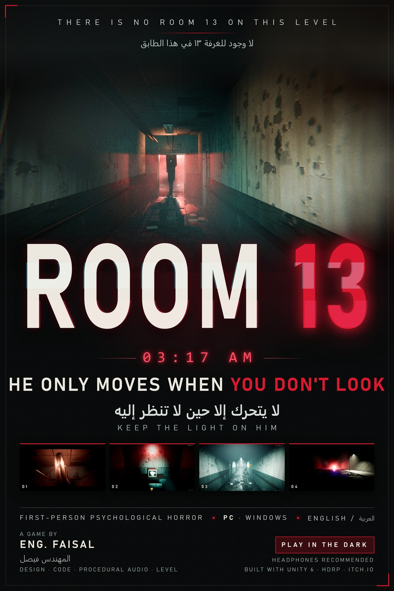

# ROOM 13

> *"There is no Room 13 on this level."*

A first-person **psychological horror** game for Windows (Unity 6, HDRP).
It is 3:17 AM. You are Patient 013. Something tall and silent only moves when you stop looking at it, and it cannot stand the light - so you keep the light on him, and run.

- Single-player, ~7-15 minutes, English / Arabic
- Stalker AI that reacts to light, noise and whether you are looking at it
- Level, textures and **all audio are generated by code at runtime**
- Always-visible route marker (distance + edge arrow)
- Final-chase **slide**: sprint, then press `C` / `Ctrl`

## Download
- **Windows build (v1.0, 58 MB):** [ROOM13_Windows.zip](https://github.com/FaisalAlghates/ROOM13/releases/download/v1.0/ROOM13_Windows.zip) - [Releases page](https://github.com/FaisalAlghates/ROOM13/releases)
- Also on itch.io: https://engfaisalalghates.itch.io/room13
- Unzip, then run `ROOM13_Launcher.exe` (or `Game\ROOM13.exe`).
## Controls
`WASD` move · `Mouse` look · `Shift` sprint · `C`/`Ctrl` crouch (slide while sprinting in the last stage) · `E` interact / hide · `F` flashlight · `R` change battery · `G` / `RMB` throw · `Tab` phone / map · `H` hint · `Esc` pause · `F11` window / fullscreen · `L` language (menu)

## What is in this repository
This repo holds the **source of the modifications and the documents**. The game binaries are not stored here (they are large) - download the Windows build from [Releases](https://github.com/FaisalAlghates/ROOM13/releases) or the itch.io page.

| Path | Content |
|---|---|
| `docs/ROOM13_Game_Design_Document.pdf` | Game Design Document (16 pages, follows the Unity GDD template) |
| `docs/ROOM13_Poster*.png / .pdf / .jpg` | Poster (2400x3600) |
| `docs/screenshots/` | In-game screenshots |
| `docs/source/` | HTML sources of the GDD and the poster, with images |
| `mod/Slide.cs` | Final-stage running slide (hooks into `PlayerController`) |
| `mod/IronDoor.cs` | Procedural old-iron-door sounds + slide scrape (pure C#, no Unity dependency) |
| `mod/Launcher.cs` | Windows launcher (Play Fullscreen / Window / Watch Auto-Play) |
| `mod/apply_patches.ps1` | Rebuilds `Assembly-CSharp.dll` from the pristine `.bak` and applies every patch (needs Mono.Cecil from a Unity editor install and `csc.exe`) |
| `itch/` | itch.io page text, cover images and upload notes |

### Applying the patches
1. Put the original `Assembly-CSharp.dll` next to the game as `Assembly-CSharp.dll.bak` (`Game/ROOM13_Data/Managed`).
2. Run `mod/apply_patches.ps1 -Root <folder that contains Game\> -Cecil <path to Mono.Cecil.dll>`.
3. Play-test with `ROOM13.exe -autotest` (built-in autopilot plays all 11 stages in ~7 minutes).

## Requirements
Windows 10/11 64-bit, DirectX 12 GPU. Headphones recommended. The executables are not code-signed (SmartScreen may warn).

## Credits
Design, code, procedural audio and level: **Eng. Faisal** (المهندس فيصل). Built with Unity 6 - HDRP. The project was developed with an AI assistant.

---

## بالعربي
**ROOM 13** لعبة رعب نفسي بمنظور الشخص الأول لنظام Windows. الساعة 3:17 فجرًا، وأنت المريض 013 في مستشفى فيه باب ثالث عشر لا ينبغي أن يوجد. كائن طويل لا يتحرك إلا حين لا تنظر إليه ولا يتحمّل الضوء، فأبقِ الضوء عليه واهرب.

هذا المستودع يحوي أكواد التعديلات والوثائق (وثيقة تصميم اللعبة GDD والبوستر واللقطات). ملف اللعبة نفسه لا يُحفظ هنا بسبب حجمه، وتجده في [Releases](https://github.com/FaisalAlghates/ROOM13/releases) أو صفحة itch.io.

التحكم: W A S D حركة · Shift ركض · C أو Ctrl انحناء / انزلاق أثناء الركض في المرحلة الأخيرة · E تفاعل · F الكشاف · R بطارية · G رمي · Tab الهاتف والخريطة · H تلميح · L اللغة.
